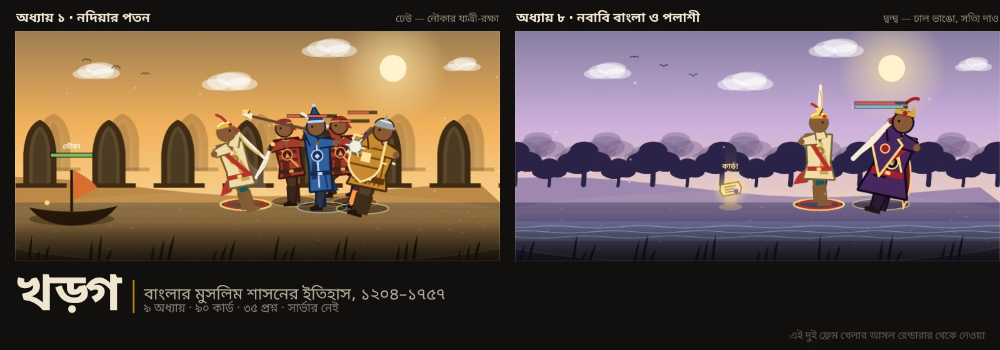

<a href="https://titaniaroro.github.io/Khadga/">
  
</a>

<h1 align="center" style="font-size:2.6em;letter-spacing:.06em">খড়্গ</h1>

<p align="center">
  <b>বাংলার মুসলিম শাসনের ইতিহাস, ১২০৪–১৭৫৭ — তলোয়ারের ধার ধরে ধরে</b><br>
  ৯টি অধ্যায় · ৯০টি ইতিহাস-কার্ড · ৩৫টি প্রশ্ন · সম্পূর্ণ বাংলা UI · সার্ভার নেই
</p>

<p align="center">
  <a href="https://github.com/TitaniaRoro/Khadga/actions/workflows/ci.yml"></a>
  <a href="https://titaniaroro.github.io/Khadga/"></a>
  
  
  
  
  
  
</p>

<p align="center"><sub><a href="#এক-নজরে">এক নজরে</a> · <a href="#খেলাটা-কী">খেলাটা কী</a> · <a href="#অধ্যায়">অধ্যায়</a> · <a href="#নিয়ন্ত্রণ">নিয়ন্ত্রণ</a> · <a href="#নামানো-ও-চালানো">নামানো ও চালানো</a> · <a href="#নীতি">নীতি</a> · <a href="#ইতিহাস-যেভাবে-সত্য-থাকে">ইতিহাস যেভাবে সত্য থাকে</a> · <a href="#ফাইলের-নকশা">ফাইলের নকশা</a> · <a href="#যাচাই-আর-বাকি">যাচাই আর বাকি</a> · <a href="#প্রকাশ-ও-রেপো-সেটিংস">প্রকাশ ও রেপো সেটিংস</a></sub></p>

<p align="center"><sub><bdi lang="en">A serverless, Bengali-language 2D fighting game that teaches the history of Muslim Bengal, 1204–1757.</bdi></sub></p>

---

## এক নজরে

| | |
|---|---|
| **খেলুন** | <https://titaniaroro.github.io/Khadga/> — ডাউনলোড, ইনস্টল, অ্যাকাউন্ট, কিছুই নয় |
| **জানালা** | ১২০৪ (নদিয়ার পতন) → ১৭৫৭ (পলাশী)। শুরুটি লড়াই ছাড়া: বণিক ও আউলিয়া (৮ম–১২শ শতাব্দী) |
| **আপনি কে** | কোনো সুলতান নন। একই অজ্ঞাত কারিগরের হাতে গড়া খড়্গের **ধারক-বংশ** — প্রতি অধ্যায়ে হাত বদলায়, তাই সাড়ে পাঁচশো বছর এক সুতোয় বাঁধা থাকে |
| **ইঞ্জিন** | নিজে লেখা, ৬০Hz ফিক্সড-স্টেপ, কোনো ফ্রেমওয়ার্ক নয়। লড়াইয়ের পুরো নিয়ম `src/frames.ts`-এর এক-টেবিলে, আর ওই টেবিলই টেস্টে আটকানো |
| **লড়াই** | ১৭টি ঢেউ (রক্ষা-মিশন) + ৮টি দ্বন্দ্ব (ঢাল-ভাঙা + প্রশ্ন) + অসীম ঢেউ ও সত্য-দৌড়। টানা-আঘাত, স্কোর, তারা — কিন্তু জয়ের শর্ত সর্বদা *কিছু বাঁচানো*, কখনও *সব মারা* নয় |
| **পড়াশোনা** | মাঠে সোনালি স্ক্রল তুললেই কার্ড খোলে (সংকল্প + বোনাস + স্কোর); ঢাল ভাঙলে সময় ধীরে চলে যাতে প্রশ্ন সত্যিই পড়া যায়; ফলাফলে "যা শিখলে"-র পুনরালোচনা, আর সত্য-দৌড়ে ভুলগুলো শেষে শেখানো হয় |
| **আর্ট ও শব্দ** | আধুনিক HD ছায়া-পুতুল: চার-তলা প্যারালাক্স, হাঁটার চক্র, তলোয়ারের ঝাপটা, কণা-এফেক্স, ক্যামেরা-দোলন (পিক্সেল-রূপ টগলে ঐচ্ছিক)। নায়ক, প্রতিটি শত্রু-ধরন, বস ও মিত্রের আলাদা পোশাক, মাথার ঢাকা, বুকের প্রতীক, অস্ত্র ও গড়ন; শরীরের সংঘর্ষে মূর্তিগুলো একে অপরের ভেতর মিশে যায় না। সব শব্দ কোডে বানানো (WebAudio): প্রথম পর্দায় স্পষ্ট শব্দ-ফটক, তারপর ঢোলের তাল, বাতাস, নিজের ও শত্রুর সুইং, সতর্ক-ঝলকের বিপসহ লড়াইয়ের SFX — ফাইল ছাড়াই। রক্ত, মৃতদেহ নেই |
| **সাইজ** | খেলা ০.৪২MB (ফন্টসহ), নকশা-ব্রিফসহ সাইট ০.৪৮MB; ৬MB-তে ছাড়ালে **বিল্ড থামে** |
| **নির্ভরতা** | প্রোডাকশনে দুটো ফন্টই — Hind Siliguri ১৪+১৪KB, Noto Sans Bengali ৪৪+৪৬KB (মোট ১১৮KB)। বাকি সব ভ্যানিলা টাইপস্ক্রিপ্ট + ক্যানভাস |
| **অফলাইন + তাজা** | Service Worker, কোনো CDN/অ্যানালিটিক্স/ট্র্যাকার নেই — একবার খুললে পরে ইন্টারনেট লাগে না, অথচ নতুন বিল্ড তবু পৌঁছোয়: শেল নেটওয়ার্ক-আগে, অ্যাসেটে `?v=<রিভিশন>`, ক্যাশের নামই রিভিশন, আর টাইটেল-পর্দায় **সংস্করণ-ছাপ** |
| **লাইসেন্স** | কোড GPL-3.0 · সামগ্রী CC BY-SA 4.0 · [CREDITS.md](CREDITS.md) |

> **এক লাইনে:** দুই বন্ধু লড়াই করতে করতে মনে রাখবে — সোনারগাঁওয়ে দিল্লির কর অস্বীকার করে স্বাধীনতা ঘোষণা হয়েছিল (অধ্যায় ৩), রাজমহলের প্রান্তরে হাতির আক্রমণেই শেষ স্বাধীন সুলতানি ভেঙে পড়েছিল (অধ্যায় ৫), আর পলাশীর আম্রকাননে বাঁচাতে হতো কামান-ব্যাটারি (অধ্যায় ৮)। তারিখ-সংখ্যা এই README-এ লেখা নয় — প্রতিটি কার্ডে আছে, উৎসসহ।

## খেলাটা কী

লড়াই এখানে শাস্তি নয়, **মাধ্যম**। তিনটি চক্র একসাথে চলে — কোনোটাই থামানো হয় না:

```
ঢেউ ১৭টি ──► কার্ড ৯০টি ──► দ্বন্দ্ব ৮টি ──► প্রশ্ন ৩৫টি
```

| চক্র | কী ঘটে | হেরে যাওয়া মানে |
|---|---|---|
| **ঢেউ** (১৭টি) | ঢেউ-লড়াই (beat 'em up): নৌকা / ধান / তোরণ ৯০ সেকেন্ড ধরে রাখুন; চার ধরনের শত্রু, বড় আঘাতের আগে লাল সতর্ক-ঝলক, ঢেউয়ের ফাঁকে কার্ড-বিরতি | উদ্দেশ্য ভেঙে পড়া — সব শত্রু মারা জয়ের শর্ত **না**, নিষ্ক্রিয় থাকা মানে হার |
| **কার্ড** (৯০টি) | মাঠে ভাসা সোনালি স্ক্রল ছুঁলেই কার্ড: মিটার ১২ (দ্বন্দ্বে ১৮), স্কোর, আর ৩৭টি "বর"-এর যেকোনোটি চালু; সময় তখন একটু ধীরে চলে | পড়া না পড়লে মিটার ভরে না — তাই সংকল্প-আঘাত (মিটার ১০০ লাগে) আসে না |
| **দ্বন্দ্ব** (৮টি) | ঢাল ভাঙান → ধীর-সময়ে প্রশ্ন (নিজস্ব ঘড়ি-পটি; আগে মাত্র ৪৬ ফ্রেম ছিল — কোনো মানুষের পক্ষে অসম্ভব) → **সঠিক ৩টি = জয়**; প্রতিটি সত্যির পর বস ক্ষিপ্ততর পর্বে ওঠে | ভুল উত্তরে প্রাণ কমে না, মিটার −১৪; লড়াই থামে না |

প্রাণ ২৪০ / ঢাল ১০০ — অর্থাৎ কেউ এক কোপে মরে না, আর ঢাল চিরকাল টেকে না।

## অধ্যায়

সারিগুলো `content/chapters.json` থেকে তৈরি — টেবিল হাতে লেখা নয়, তাই সংখ্যা কখনও পুরোনো হবে না:

| # | অধ্যায় | সময় | খড়্গের ধারক (বয়স) | ঢেউ | দ্বন্দ্বের মূল | কার্ড | প্রশ্ন |
|---|---|---|---|---|---|---|---|
| ০ | বণিক ও আউলিয়া | ৮ম–১২শ শতাব্দী | অজ্ঞাত কারিগর | — | — | ৮ | ৩ |
| ১ | নদিয়ার পতন | ১২০৪–১২০৬ | রুহাম, ১৯ | ২ | লুণ্ঠনকারী দলের পথ-রোধ | ৯ | ৪ |
| ২ | দিল্লির ছায়া | ১২০৬–১৩৩৮ | সাইরা, ৩৪ | ২ | নদীমুখে জাহাজ-রক্ষা | ৯ | ৪ |
| ৩ | সোনারগাঁও: স্বাধীনতা | ১৩৩৮–১৩৫৮ | আশিক, ২৭ | ২ | সোনারগাঁওয়ের গেট | ৮ | ৪ |
| ৪ | পান্ডুয়া থেকে গৌড়: ইট ও কবিতা | ১৩৫৮–১৫৩৮ | কামাল, ৪১ | ২ | মসজিদের উঠোনে অনুষ্ঠিত 'দরবারি দ্বন্দ্ব' | ১২ | ৪ |
| ৫ | সুরি ও কররানী: শেষ স্বাধীন সুলতান | ১৫৩৮–১৫৭৬ | নাসির, ৩০ | ২ | রাজমহলের প্রান্তর | ১২ | ৪ |
| ৬ | বারো ভূঁইয়া: নদী-জঙ্গলের যুদ্ধ | ১৫৭৬–১৬১০ | জামাল, ২৪ | ৩ | ভাওয়ালগড়ের জলে মুঘল নৌ-সর্দার | ১০ | ৪ |
| ৭ | সুবা বাংলা ও ঢাকার জৌলুশ | ১৬১০–১৭১৭ | সালমা, ৩৬ | ২ | বুড়িগঙ্গার মুখে মগ-জাহাজ আটকানো | ১১ | ৪ |
| ৮ | নবাবি বাংলা ও পলাশী | ১৭১৭–১৭৫৭ | ফয়জুল, ৪৫ | ২ | পলাশীর আম্রকানন | ১১ | ৪ |

**যা পাবেন না:** কোনো ঐতিহাসিক ব্যক্তি বস নন — কখনওই না। ইলিয়াস শাহ, খান জাহান আলী, ইসা খাঁ, শাইস্তা খাঁ, সিরাজুদ্দৌলা সবাই সংলাপ, প্রেক্ষাপট ও শিক্ষক হিসেবে থাকেন; লড়াই হয় তাদের বিরুদ্ধে নয়। মরমি আউলিয়া কাউকে পাওয়ার-আপও বানানো হয় না — `validate`-র `venerated-boss` নিয়মটা এটাই আটকায়।

## নিয়ন্ত্রণ

ডেস্কটপ আর মোবাইলে **একই ৬টি ইনপুট** — মোবাইলের জন্য সহজ-করা সংস্করণ নয়, ফ্রেম-ডেটা হুবহু এক।
৬টি ইনপুটই <kbd>1</kbd>–<kbd>6</kbd> সংখ্যা-কী-তেও পাওয়া যায় (মোবাইলে যে দাপন আঁকা, সে-ই)।

| ইনপুট | কাজ | ডেস্কটপ | মোবাইল |
|---|---|---|---|
| **কাটা** | সবচেয়ে দ্রুত; ঢাল ভাঙে না | <kbd>J</kbd> | ১ |
| **কোপ** | ধীর, ভারী; ঢাল-ক্ষয় সবচেয়ে বেশি | <kbd>K</kbd> | ২ |
| **পোঁতা** | সবচেয়ে লম্বা পাল্লা; ভুল জায়গায় দীর্ঘ শাস্তি | <kbd>L</kbd> | ৩ |
| **রোধ / প্রতিউত্তর** | ৮-ফ্রেমের নিখুঁত জানালা | <kbd>Space</kbd> | ৪ |
| **সবে** | ১০ ফ্রেম অছোঁয়া, তারপর দুর্বল | <kbd>Shift</kbd> | ৫ / সোয়াইপ |
| **সংকল্প** | চরম আঘাত; মিটার ১০০ লাগে | <kbd>U</kbd> | ৬ |

চলাফেরা অ্যারো / <kbd>W</kbd><kbd>A</kbd><kbd>S</kbd><kbd>D</kbd>, মোবাইলে বাঁ-পাশের ভার্চুয়াল স্টিচ; প্রশ্নের উত্তর <kbd>1</kbd>–<kbd>4</kbd> বা ট্যাপ।

<details>
<summary><b>ফ্রেম-ডেটা</b> — ৬০Hz-এর সংখ্যা, নকশার মেরুদণ্ড (খুলুন)</summary>

| মুভ | startup / active / recovery | পাল্লা | ক্ষতি | ঢাল-ক্ষয় | hitstun | blockstun | মিটার |
|---|---|---|---|---|---|---|---|
| কাটা | ৪ / ৪ / ৯ | ৫৮ | ৬ | ৪ | ১৪ | ৮ | +৪ |
| কোপ | ১১ / ৫ / ২০ | ৬৬ | ১৫ | ৩৪ | ২৪ | ১২ | +৮ |
| পোঁতা | ৯ / ৩ / ২২ | ১০৪ | ১২ | ১২ | ২০ | ১০ | +৬ |
| রোধ | ১ / ২৬ / ৬ | — | — | — | — | — | +২ |
| সবে | ২ / ০ / ১২ | — | — | — | — | — | +১ |
| সংকল্প | ৬ / ৮ / ২৬ | ৮২ | ৩৪ | ৪০ | ৪০ | ৩০ | −১০০ |

`FPS 60 · MAX_HP ২৪০ · MAX_GUARD ১০০ · PARRY_WINDOW ৮ · GUARD_BREAK_STUN ৪৬ · RESOLVE_COST ১০০`

এই টেবিলটিই `tests/frames.test.ts` আটকে রাখে: নকশা বদলালে সংখ্যা বদলাবে, টেস্ট লাগাবে। ভারসাম্যের নীতি স্বাদ-অনুমান নয়, হিসাব: হালকা দ্রুত কিন্তু ঢাল ভাঙে না, ভারী ধীর কিন্তু ঢাল-ক্ষয় ৩৪, পোঁতার পাল্লা ১০৪ কিন্তু রিকভারি ২২।

</details>

## নামানো ও চালানো

```bash
git clone https://github.com/Titaniaroro/Khadga.git && cd Khadga
npm ci
npm run check                          # validate → typecheck → build → test → preview
python3 -m http.server 8124 --bind 0.0.0.0 --directory docs
```

<http://localhost:8124> = খেলা। শুধু সামগ্রী পড়তে চাইলে `docs/content-preview.html` — ৯ অধ্যায়ের ৯০ কার্ড আর ৩৫ প্রশ্ন এক পাতায়।

| কমান্ড | কী |
|---|---|
| `npm run validate` | `content/chapters.json`-এ ৬২টি নিয়ম-কোড; একটিও ভাঙলে বিল্ড ওঠে না |
| `npm run typecheck` | `tsc --noEmit` |
| `npm run build` | validate + typecheck + esbuild + ফন্ট-কপি + SW → `docs/` (সাইজ-বাজেটে থামায়) |
| `npm test` | ৪৬টি টেস্ট; `docs/` না থাকলে DOM-স্মোক ৫টি কারণ দেখিয়ে `skip` করে (CI-তে ফেল) |
| `npm run preview` | `docs/content-preview.html` |
| `npm run serve` | `docs/` স্ট্যাটিক সার্ভার |
| `npm run playtest` | রোবট প্রতিটি অধ্যায় দুই ধরনে খেলে দেখায়: জয়/পরাজয় আর আটকানো ক্র্যাশ |
| `npm run hero` | README-র হেরো ও `og.png` — খেলার আসল রেন্ডারার থেকে ফ্রেম তুলে নেয় |

`docs/` ট্র্যাক করা হয় না (বিল্ড-আউটপুট) — নিচে থাকে শুধু [design-khadga.md](docs/design-khadga.md)।

## নীতি

৬২টি যাচাই-নিয়মের পেছনে এই কয়েকটা সিদ্ধান্ত, যা ইচ্ছা করলেও চুপচাপ বদলানো যায় না:

১. **কোডে এক ঘণ্টার ইতিহাসও নেই।** তারিখ, নাম, সংখ্যা, দাবি — সব `content/chapters.json`-এ; ইঞ্জিন পড়ে, লেখে না।
২. **প্রতিটি দাবিতে উৎস বাধ্যতামূলক** — ১১টি উৎসের লেজেন্ড, ১০৭টি আলাদা উৎস-স্ট্রিং ৯০টি কার্ডে।
৩. **মতভেদ ঢাকা পড়ে না।** ১১টি কার্ডে দুই পক্ষই দেখানো হয় — নালন্দার ধ্বংস-তারিখ, "কালকুঠরি"র একমাত্র সূত্র, প্রাচীনতম মুসলিম-লিপির খোঁজ-কাহিনি; ঐ সংখ্যাগুলো কার্ডেই আছে, এখানে পুনরাবৃত্তি হয় না। উৎস একপক্ষ হয়েও দাবি নিশ্চিত হলে `disputed-views` বিল্ড থামায়।
৪. **জোরপূর্বক ধর্মান্তর বিজয়-কথা নয়।** শতাব্দী-ধরে কৃষি-ভূমি-সূফি-রাস্তায় সংখ্যাগরিষ্ঠতা গড়া — Eaton-এর ব্যাখ্যাই খেলার মূল সুর; `forced-conversion` নিয়মটা তাই আটকায়।
৫. **সহাবস্থান সাজানো মোড়ক নয়, তথ্য।** ৩০টি কার্ডে `syncretism` ট্যাগ, প্রতি অধ্যায়ে অন্তত একটি — `syncretism-rule` না মানলে বিল্ড নেই।
৬. **রক্তপাত নেই।** আঘাতের শব্দ ও ছায়াই যথেষ্ট; লড়াইয়ের লক্ষ্য সবসময় রক্ষা বা ঢাল-ভাঙা।
৭. **UI ১০০% বাংলা।** `script` / `latin` / `digits` নিয়ম তিনটি ল্যাটিন-দেবনাগরী-CJK অক্ষর এবং ইংরেজি অঙ্ক দেখলে ফেল করে (ব্যতিক্রম: <kbd>Shift</kbd> <kbd>Space</kbd> <kbd>J</kbd> <kbd>K</kbd> <kbd>L</kbd> <kbd>U</kbd> — কী-র নাম)।

## ইতিহাস যেভাবে সত্য থাকে

`tools/validate.mjs` সামগ্রীর ওপর ৬২টি নিয়ম চালায়। গুরুত্বপূর্ণগুলো:

| নিয়ম | কী আটকায় (বার্তার সারমর্ম) |
|---|---|
| `card-sources`, `card-source-key`, `card-source-weak` | উৎসবিহীন কার্ড; লেজেন্ডের বাইরে যাওয়া উৎস; ৪ অক্ষরেরও ছোট উৎস |
| `disputed-views`, `views-undisputed` | মতভেদের কার্ডে এক পক্ষই, বা ২৫ অক্ষরের চেয়ে ছোট পক্ষ; `views` আছে অথচ `disputed` নয় |
| `hedge` | মাঝ-বাক্যে `?` — "যাচাই বাকি" চিহ্ন নিয়ে দাবি খেলার লেখায় ঢুকতে পারবে না |
| `forced-conversion` | জোরপূর্বক ধর্মান্তরকে ন্যায়সঙ্গত দাবি করা (নাকচ-সহ প্রসঙ্গ হলে চলে) |
| `venerated-boss`, `boss-missing`, `boss-without-fight`, `boss-name` | পূজনীয় ব্যক্তিত্ব প্রতিপক্ষ হওয়া; লড়াই থাকলে প্রচলিত-ভ্রম-ভাঙা `boss` ব্লক বাধ্যতামূলক |
| `syncretism-rule` | কোনো অধ্যায়ে সংমিশ্রণ-বা সহাবস্থান-কার্ড না থাকা |
| `script`, `latin`, `digits` | দেবনাগরী / CJK / আরবি / আসামি লিকেজ; ল্যাটিন শব্দ; ASCII সংখ্যা |
| `quiz-answer`, `quiz-explain`, `quiz-card`, `quiz-choices-dup` | `answer` ০–৩ নয়; ২০ অক্ষরের চেয়ে ছোট ব্যাখ্যা; নেই-থাকা কার্ডের ইশারা; কপিকেল অপশন |
| `card-year`, `card-span`, `card-quote`, `card-dup` | অধ্যায়ের কালসীমা ছাড়ানো; `quote` টাইপে উদ্ধৃতিচিহ্ন নেই; একই id দুবার |
| `cards-count`, `quiz-count`, `tactics-count`, `fight-waves`, `panels`, `prologue-only` | অধ্যায়-প্রতি অসম্পূর্ণতা (কার্ড ৬–১২, ঢেউ ১–৪); লড়াইবিহীন অধ্যায় শুধুই ০ |
| `chapter-order`, `chapter-slug`, `card-tag`, `meta-key`, `legend-key` | id ক্রমহীন; স্লাগ অমিল; `TAGS`-এর বাইরের ট্যাগ; ম্যাটা ফিল্ড/উৎস-কী নেই |
| `placeholder`, `empty` | TODO/FIXME/`undefined` মিশে থাকা লেখা; ফাঁকা ফিল্ড |

<details><summary>৬২টি নিয়ম-কোডের পুরো তালিকা (যান্ত্রিকভাবে গণনা)</summary>

`bearer-extra-key`, `boss-extra-key`, `boss-missing`, `boss-name`, `boss-without-fight`, `card-dup`, `card-extra-key`, `card-id`, `card-long`, `card-quote`, `card-short`, `card-source-key`, `card-source-weak`, `card-sources`, `card-span`, `card-tag`, `card-tags`, `card-type`, `card-year`, `cards-count`, `chapter-extra-key`, `chapter-key`, `chapter-order`, `chapter-slug`, `chapters`, `digits`, `disputed-views`, `empty`, `fight-waves`, `forced-conversion`, `hedge`, `language`, `latin`, `legend-key`, `meta`, `meta-key`, `meta-legend`, `meta-span`, `panels`, `panels-punct`, `placeholder`, `prologue-only`, `quiz-answer`, `quiz-card`, `quiz-choices`, `quiz-choices-dup`, `quiz-count`, `quiz-dup`, `quiz-explain`, `quiz-extra-key`, `quiz-id`, `quiz-mark`, `script`, `source-unnamed`, `syncretism-rule`, `tactic-card`, `tactic-dup`, `tactic-extra-key`, `tactics-count`, `type`, `venerated-boss`, `views-undisputed`

</details>

সংশোধন করতে চাইলে শুধু JSON বদলান → `npm run validate`। কোনো নিয়ম কেন আছে জানতে `content/schema.json`-এর প্রতি-ফিল্ডের কারণ-লেখা দেখুন।

## ফাইলের নকশা

```
content/chapters.json  ৯ অধ্যায় · ৯০ কার্ড · ৩৫ প্রশ্ন — একমাত্র সত্য-উৎস (১৪৭KB)
content/schema.json    রূপ + প্রতিটি নিয়মের কারণ
tools/validate.mjs     ৬২টি নিয়ম; ০ ভুল + ০ সতর্কতা না হলে বিল্ড থামে
tools/build.mjs        esbuild + ফন্ট-কপি + SW → docs/   (৬MB-এ ছাড়ালে থামে)
tools/preview.mjs      → docs/content-preview.html
src/frames.ts          ফ্রেম-ডেটা — লড়াইয়ের একমাত্র সত্য
src/fighter.ts         স্টেট-মেশিন; DOM / Canvas / Date.now() / random-মুক্ত
src/sim.ts             ঢেউ + দ্বন্দ্ব + মিটার; একই বীজ ও ইনপুট = হুবহু এক লগ
src/save.ts            লোকাল প্রগ্রেস (localStorage)
src/input.ts           কীবোর্ড + ভার্চুয়াল স্টিচ — ৬ ইনপুট, দুই প্ল্যাটফর্মে
src/render.ts          আধুনিক HD রেন্ডারার (প্যারালাক্স, কণা, swoosh, ক্যামেরা; ছবি-ফাইল নেই, পিক্সেল-রূপ ঐচ্ছিক)
src/audio.ts           WebAudio-তে কোডে-বানানো তাল ও SFX — অডিও-ফাইল নেই
src/hud.ts src/game.ts মিটার, কার্ড, দ্বন্দ্ব-প্রশ্ন, সিন-মেশিন
src/main.ts            boot — একমাত্র DOM-ছুঁয়ে থাকা ফাইল
web/                   index.html + styles.css (উৎস; বিল্ড `docs/`-এ কপি করে)
tests/                 ৯ (frames) + ২৭ (sim) + ৭ (dom-smoke) = ৪৬
docs/design-khadga.md  নকশা-ব্রিফ ও সিদ্ধান্ত-রেকর্ড
.github/workflows/ci.yml  যাচাই ও প্রকাশ · .github/repo-meta.json  রেপোর About/টপিক/হোমপেজ
```

সীমাবদ্ধতাগুলো এলোমেলো নয়: `frames` / `fighter` / `sim` ব্রাউজার-বস্তু থেকে বিচ্ছিন্ন, তাই রিসেড-টেস্টে ৯টির মধ্যে ৮টি অধ্যায়ই ৬০০ ফ্রেম ধরে দুই মোডে চলে; রেন্ডারার বা HUD ভাঙলে তা ধরে DOM-স্মোক টেস্ট — নকল DOM-এ **আসল `docs/app.js` চালিয়ে**।

## যাচাই আর বাকি

| দাবি | অবস্থা |
|---|---|
| সামগ্রীর ৬২টি নিয়ম | ✅ প্রতি বিল্ডে, `main`-এর CI-তেও |
| লড়াই-নিয়ম, ঢেউ-জয়/পরাজয়, দ্বন্দ্বের ৩-উত্তর, মিটার-নীতি, রিসেড-ধার্যতা | ✅ ৪৬টি টেস্ট |
| boot হয়, HUD ভরে, external URL/CDN নেই, বাংলা লিপি | ✅ DOM-স্মোক ৫টি |
| টাইপ, সাইজ-বাজেট | ✅ `tsc` + বিল্ড |
| **ইনপুটের অনুভূতি, সত্যিকারের ফ্রেম-রেট, মোবাইল টাচ** | ⚠️ কোনো আসল ব্রাউজারে এখনও চোখে দেখা হয়নি |
| অধ্যায় ৭–৮-এর পাতলা প্রমাণ (লালবাগ অসমাপ্তা, রাজকীয় জাহাজের সংখ্যা, পলাশীর দুই পক্ষের বলসংখ্যা, "কালকুঠরি"র হতাহতের হিসাব) | ⚠️ সংখ্যাগুলো কার্ডে আছে; এখানেই যাচাই বাকি — ঐতিহাসিক চোখ দরকার |
| "তিনজন ভারী কোপে ১০০ ঢাল ভাঙে" | ⚠️ হিসাব, প্লে-টেস্ট নয় |
| প্রতি-অধ্যায়ে আলাদা মুভসেট, দুই-খেলোয়াড় মোড, 3D→স্প্রাইট বেক | ⏭️ M1 |
| তীতুমির / ফরায়েজি / সন্ন্যাসী-ফকির যুদ্ধ (সময়সীমার বাইরে) | ⏸️ ইচ্ছাকৃত সংরক্ষণ |

## প্রকাশ ও রেপো সেটিংস

`main`-এ প্রতিটি push: `check` (validate → typecheck → build → test) পাস করলে `pages` জব `docs/` আর্টিফ্যাক্ট হিসেবে তুলে দেয় → `deploy-pages` প্রকাশ করে।

দুটো একবার-সেটিং রিপো-মালিকের হাত চায় (GitHub এই টোকেনে রেপো-সেটিং ছুঁতে দেয় না: `Resource not accessible by integration`):

```bash
gh api -X PATCH repos/Titaniaroro/Khadga --input .github/repo-meta.json     # About + 20 টপিক + হোমপেজ
gh api -X PUT   repos/Titaniaroro/Khadga/pages -f build_type=workflow        # বা: Settings → Pages → Source: GitHub Actions
```

<details>
<summary>এই পাইপলাইনে যে ৩টি নীরব ফাঁদ ইতিমধ্যে পোড়া হয়েছে — ভবিষ্যতের নোট</summary>

১. `environment:`-এর `url:` মান **YAML flow-mapping-এর ভেতর** বসালে `${{ … }}`-এর জন্য পার্সার পুরো ওয়ার্কফ্লো বাতিল করে দেয়। লক্ষণ: রান ০ সেকেন্ডে `failure`, কোনো job নেই, কোনো লগ নেই। পুরো `ci.yml` ব্লক-স্টাইলে লেখা, আর কমিটের আগে `js-yaml` দিয়ে পার্স করে দেখা হয়।
২. `actions/upload-pages-artifact` **শুধু তোলে, প্রকাশ করে না** — পেছনে `actions/deploy-pages@v4` না থাকলে ফল: CI সবুজ, Site স্থির। দর্শক কখনও জানেই না কনটেন্ট বদলায়নি।
৩. `docs/` ট্র্যাক করা হয় না, সুতরাং **টেস্টের আগে বিল্ড** না চালালে ফ্রেশ CI-চেকআউটে DOM-স্মোকের পড়ার কিছুই থাকে না। লোকালে পুরোনো বিল্ড পড়ে থাকে বলে এটা প্রথমবার ধরা পড়েনি।

</details>

---

<p align="center"><sub>
<b>লাইসেন্স:</b> কোড <a href="LICENSE">GPL-3.0</a> · সামগ্রী CC BY-SA 4.0 — <a href="CREDITS.md">ফন্ট, উৎস ও চিত্রের কৃতজ্ঞতা</a> · <a href="docs/design-khadga.md">নকশা-ব্রিফ</a><br>
হেরো-চিত্র ১৩৪KB — আগের AI-মকআপটা বাদ; দুটো ফ্রেমই `tools/hero.mjs` **আসল** সিম ও রেন্ডারার নোডে চালিয়ে তুলেছে (`npm run hero`), তাই ছবি খেলার চেহারার সঙ্গে মেলে। শৈলী: আধুনিক HD ছায়া-পুতুল (চাইলে সেটিংসে পিক্সেল-আর্কেড রূপ)<br>
এই পাতাটি <code>node tools/readme.mjs</code> থেকে জেনারেট হয়: টেবিল, ফ্রেম-ডেটা, ব্যাজের সংখ্যা — সব <code>content/</code>, <code>src/frames.ts</code> ও <code>docs/</code> থেকে তোলা। সম্পাদনা করতে চাইলে টুলটাই বদলান, তাহলে কিছু পুরোনো থাকবে না
</sub></p>
